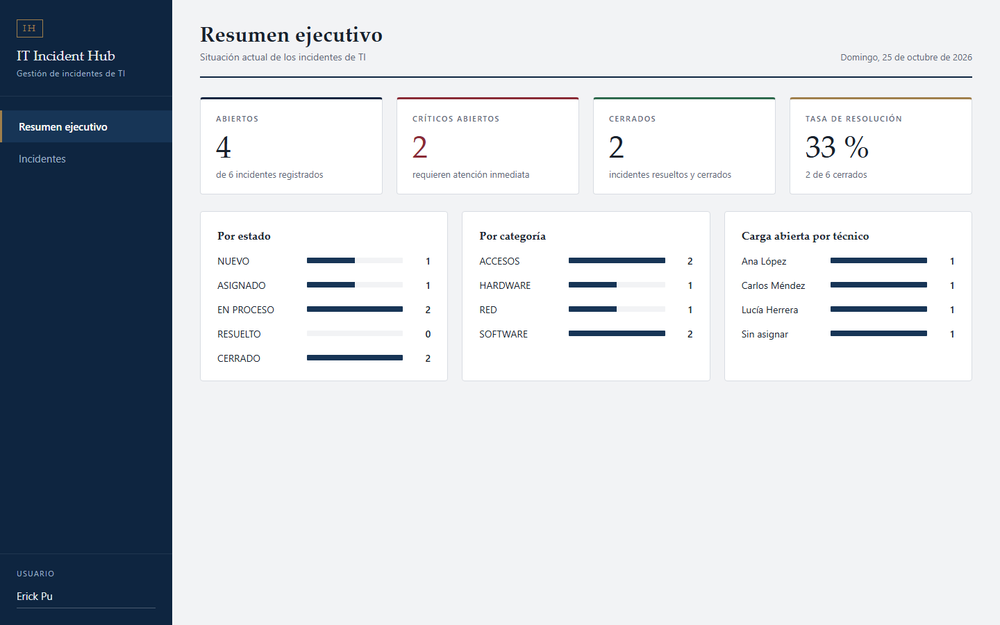
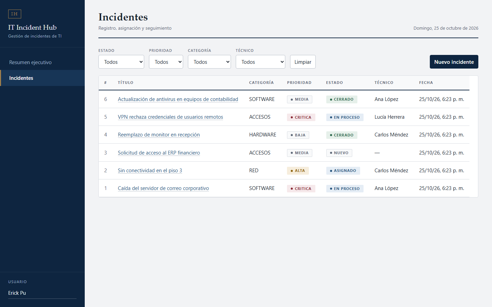

# IT Incident Hub

Solución web para registrar, operar y dar seguimiento a incidentes de TI. Sustituye los reportes dispersos en llamadas, mensajería y correo por un flujo trazable, construido como **proyecto integrador DevOps**: del backlog en Azure Boards a una versión `v1.0.0` desplegada por ambientes con aprobación.

| | |
|---|---|
| **Versión** | 1.0.0 ([CHANGELOG](CHANGELOG.md)) |
| **Azure DevOps** | https://dev.azure.com/epur/proyectoFinal |
| **Repositorios** | [semana 1](https://github.com/ErierCode/incident-hub-semana1) · [semana 2](https://github.com/ErierCode/incident-hub-semana2) · [semana 3 (final)](https://github.com/ErierCode/incident-hub-semana3) |





## Funcionalidad

- **Incidentes:** crear y consultar con título, descripción, categoría, prioridad, usuario, fecha y estado.
- **Operación:** asignar técnico y cambiar el estado `NUEVO → ASIGNADO → EN_PROCESO → RESUELTO → CERRADO` (con reapertura de `RESUELTO` a `EN_PROCESO`).
- **Seguimiento:** bitácora por incidente con comentarios y eventos automáticos de cada asignación o cambio de estado.
- **Consulta:** filtros por estado, prioridad, categoría y técnico.
- **Indicadores:** dashboard con abiertos, cerrados, críticos y distribución por categoría y por técnico.
- **Integración:** API REST sobre PostgreSQL; la misma aplicación sirve la interfaz web.

## Requisitos

- Node.js 20 o superior (probado con 22 LTS y 24)
- Docker Desktop (PostgreSQL local)
- Git

## Instalación

```bash
git clone https://github.com/ErierCode/incident-hub-semana3.git
cd incident-hub-semana3
cp .env.example .env        # definir DB_PASSWORD (única variable obligatoria)
npm install
```

## Ejecución

Desarrollo, con recarga automática:

```bash
docker compose up -d        # PostgreSQL 16 en el puerto 5432
npm run migrate             # esquema + datos iniciales
npm run dev:api             # API en http://localhost:3000
npm run dev -w frontend     # interfaz en http://localhost:5173 (proxy a la API)
```

Aplicación completa en un solo proceso, como en los ambientes:

```bash
npm run build               # compila el frontend en frontend/dist
npm run start -w backend    # API + interfaz en http://localhost:3000
```

Verificar: `curl http://localhost:3000/health`

## Ambientes desplegados

| Ambiente | URL | Despliegue |
|---|---|---|
| DEV | http://localhost:3001 | Automático en cada push a `main` |
| QA | http://localhost:3002 | Al crear un tag `vX.Y.Z` |
| PROD | http://localhost:3003 | Al crear un tag, tras **aprobación manual** |

Los tres corren en el agente self-hosted, cada uno con su propia base de datos PostgreSQL. Detalle en [docs/release-strategy.md](docs/release-strategy.md).

## API REST

| Método | Ruta | Descripción |
|---|---|---|
| GET | `/health` | Estado del servicio, versión y base de datos |
| GET | `/api/incidents` | Lista; filtros `?status=&priority=&category=&technicianId=` |
| POST | `/api/incidents` | Crea incidente `{ title, description, category, priority, reportedBy }` |
| GET | `/api/incidents/:id` | Detalle |
| PATCH | `/api/incidents/:id/assign` | Asigna técnico `{ technicianId, changedBy? }` |
| PATCH | `/api/incidents/:id/status` | Cambia estado `{ status, changedBy? }` |
| GET | `/api/incidents/:id/comments` | Bitácora (comentarios + eventos del sistema) |
| POST | `/api/incidents/:id/comments` | Agrega comentario `{ author, message }` |
| GET | `/api/technicians` | Técnicos disponibles |
| GET | `/api/dashboard` | Indicadores: abiertos, cerrados, críticos, por categoría y por técnico |

## Pruebas y calidad

```bash
npm run lint                # ESLint (backend y frontend)
npm run build               # verificación de sintaxis del backend + build del frontend
npm test                    # Jest (backend) + Vitest (frontend)
```

Las pruebas del backend usan un PostgreSQL en memoria (pg-mem) y no necesitan Docker. El backend exige una cobertura mínima del 90 %. El smoke test post-despliegue está en `tests/smoke/smoke.js`.

## Estructura

```
backend/            API REST (Express 5, zod, pg)
frontend/           interfaz web (React 19 + Vite)
database/           migraciones SQL y seed
tests/smoke/        smoke test post-despliegue
devops/             deploy.ps1, compose de ambientes, plantilla de etapas, empaquetado
docs/               documentación
.github/workflows/  GitHub Actions (PR y release)
azure-pipelines.yml pipeline de CI/CD en Azure Pipelines
```

## CI/CD

| Sistema | Archivo | Cuándo corre |
|---|---|---|
| Azure Pipelines (agente self-hosted) | `azure-pipelines.yml` | PR → CI · `main` → CI + DEV · tag `v*` → CI + DEV + QA + PROD |
| GitHub Actions | `.github/workflows/ci.yml` | PR y `main`: lint, pruebas, integración con PostgreSQL real, dependencias y gitleaks |
| GitHub Actions | `.github/workflows/release.yml` | Tag `v*`: publica el GitHub Release con el paquete |
| Dependabot | `.github/dependabot.yml` | Semanal |

## Documentación

- [Arquitectura](docs/architecture.md)
- [Estrategia de ramas](docs/branching.md)
- [Deuda técnica](docs/tech-debt.md)
- [Seguridad y secretos](docs/security.md)
- [Análisis de dependencias](docs/dependencies.md)
- [Estrategia de release](docs/release-strategy.md)
- [Evidencias DevOps (pipelines fallidos y correcciones)](docs/evidence.md)
- [Cumplimiento del enunciado](docs/cumplimiento.md)
- [Guía de la demostración](docs/demo.md)

## Responsables

| Integrante | Rol |
|---|---|
| Erick Pu (`ErierCode` / `epur@miumg.edu.gt`) | Desarrollo, DevOps y documentación |

Proyecto individual: las contribuciones están en el historial de Git y en los work items de Azure Boards (proyecto `proyectoFinal`, organización `epur`).
